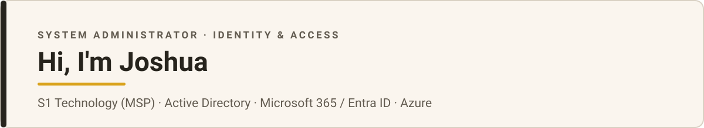

# 

**Lead Engineer, CMMC & GCC High at S1 Technology (MSP).** 4+ years at managed service providers · Active U.S. Secret clearance · U.S. Army National Guard Sergeant (E-5) · B.S. Cybersecurity

I lead engineering for CMMC and GCC High client environments, and cover security operations and systems administration: security tickets in SentinelOne, Defender XDR and Sentinel, plus user accounts and onboarding, Microsoft 365 and Entra ID, and Windows servers. When a problem at work needs a better design, I build it out on a separate tenant, document it, and publish a version here with client details removed. I approach it the way I'd run a client engagement: model the business first, then design access, security controls and automation around it.

🌐 **Portfolio site:** https://joshuarichard116-sudo.github.io/jrichard-web/

🔥 **Playable firewall lab:** [Talvex Firewall Lab](https://joshuarichard116-sudo.github.io/jrichard-web/labs/talvex-firewall/), a 43-mission firewall and Azure simulation that runs in your browser ([2-minute tour](https://joshuarichard116-sudo.github.io/jrichard-web/labs/talvex-firewall/tour/))

### 💼 Experience

**Lead Engineer, CMMC & GCC High · S1 Technology** (MSP) · April 2026 – present
- Triage and resolve about 30 security tickets per week across client environments using SentinelOne, Microsoft Defender XDR and Microsoft Sentinel
- Own the tuning of the organization's SentinelOne agent, cutting false positives while keeping detection coverage
- Designed a Microsoft Graph-based audit to catch billed users missed during onboarding
- Prototyped least-privilege delegated admin access for a multi-domain client tenant
- Wrote PowerShell tooling for tenant migrations and built a web GUI for the internal deployment tool
- Day-to-day work includes user accounts and onboarding in AD and Entra ID, Microsoft 365, Windows servers and file shares, and help desk escalations

**NOC Technician / Service Desk · Global Data** (MSP) · 2022 – April 2026
- Progressed from intern to full-time technician supporting multiple client networks
- Monitored client networks with Auvik; supported Cisco Meraki MX, Sophos and UniFi firewalls

**Wheeled Vehicle Mechanic (91B), Sergeant (E-5) · Louisiana Army National Guard** · 2020 – present

### 🔧 Work projects (S1 Technology)

- **Firewall configuration lab** ([play it](https://joshuarichard116-sudo.github.io/jrichard-web/labs/talvex-firewall/)): a FortiGate-style firewall and Azure simulator I designed and built with AI help. I build and test configurations there, then port them one-for-one to live environments
- **Billing audit with Microsoft Graph:** catches billed users missed during onboarding
- **Least-privilege delegated admin design** for a multi-domain client tenant
- **PowerShell cleanup script** for old-tenant Outlook and Microsoft 365 data after migrations
- **Web GUI** replacing the deployment tool's batch-script menu
- **Company standard** for initial Cisco Small Business switch setup over console
- **SentinelOne tuning:** fewer false positives, same detection coverage

### 🤖 How I use AI

AI makes me faster; I'm still the one accountable for the result.

- **Scripts:** I use Claude and Grok to draft PowerShell and other scripts, which cuts the time from idea to working tool
- **Documentation:** I use them to turn my notes into clear procedures and write-ups
- **The firewall lab:** I designed it and directed Claude and Grok to build it, then tested and fixed it
- **Sensitive data stays local:** the version of the lab that handles real configurations runs only on my own machine; the public version uses only fictional data

### 📜 Certifications

**B.S. Cybersecurity**, Louisiana State University of Alexandria (May 2026)
- **Microsoft:** Azure Administrator Associate (AZ-104) · Identity and Access Administrator Associate (SC-300) · SC-900
- **CompTIA:** Security+ · CySA+ · Security Pro
- **Cisco:** CCST Networking · CCNA in progress

### 🔭 Built for work problems

Each started with a problem from my MSP work and uses fictional company names, so the full design can be public.

| Project | What it shows |
|---|---|
| [**Meridian Steel — Access Governance & RBAC**](https://github.com/joshuarichard116-sudo/meridian-steel-access-governance) | Hybrid AD/Entra lab: department and tier RBAC, NTFS file shares with ABE, Conditional Access, PIM, PowerShell joiner/leaver automation |
| [**Azure Landing Zone + Entra Lab**](https://github.com/joshuarichard116-sudo/azure-landing-zone-entra-lab) | Minimal Azure landing zone in Bicep (Azure Policy, Log Analytics daily cap, budget alerts, free Defender plans) plus a step-by-step lab guide with CMMC practice mappings |
| [**CMMC Level 2 Enclave Toolkit**](https://github.com/joshuarichard116-sudo/cmmc-gcc-high-enclave-toolkit) | Vendor-neutral tool evaluation template and decision matrix mapped to NIST SP 800-171 control families, for GCC High enclaves |
| [**Azure Administrator Labs**](https://github.com/joshuarichard116-sudo/Azure-Administrator-Labs) | Hands-on AZ-104 labs: identity, governance, storage, compute, networking, monitoring |

### 🧰 Skills & tools

- **Network & firewall:** Cisco switching (VLANs, ACLs) · Meraki MX · Sophos · UniFi · TCP/IP, DNS, DHCP · VPN · Wireshark · Nmap
- **Cloud & identity:** Microsoft Azure · VNets, NSGs, hub-and-spoke · Azure Policy · Microsoft Entra ID · Conditional Access · PIM · Microsoft 365 · Bicep
- **Monitoring & response:** Microsoft Sentinel · Defender XDR · SentinelOne · Stellar Cyber · Auvik · Avanan · SaaS Alerts
- **Systems:** Windows Server · Active Directory · Linux (Debian, Kali) · KVM · NTFS / SMB · backups & patching
- **Scripting & automation:** PowerShell · Bash · Microsoft Graph API · Azure CLI · AI-assisted development (Claude, Grok)
- **Compliance:** CMMC · NIST SP 800-171 · Zero Trust · access reviews · joiner / mover / leaver

### 🌱 Currently

- Studying for the **Cisco CCNA** and building an **AZ-500 cloud security lab**
- Building **HR-driven onboarding automation** (HR system → AD → Entra → groups → SaaS)

### 📫 Connect

- 🌐 [Portfolio site](https://joshuarichard116-sudo.github.io/jrichard-web/)
- 💼 [LinkedIn](https://www.linkedin.com/in/joshua-richard-376140207)
- ✉ [joshuarichard116@gmail.com](mailto:joshuarichard116@gmail.com)

<!-- pizzazz-recipe: {"pz":1,"kit":"my-color-profile","concept":"Spec Sheet","family":"refined","dev":{"intensity":"standard","flourish":"amber dividers","structure":"slim header"},"sig":"amber rule dividers","pal":{"pri":"#27241D","sec":"#423D33","tint":"#FAF5EE","zeb":"#F7F3EC","mut":"#625B50","ftr":"#6B6358","hair":"#D9D1C4","acc":"#D9A21B","watch":"#B44D12"},"font":{"h":"system-ui","b":"system-ui"},"date":"2026-11-18"} -->
